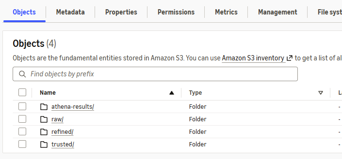
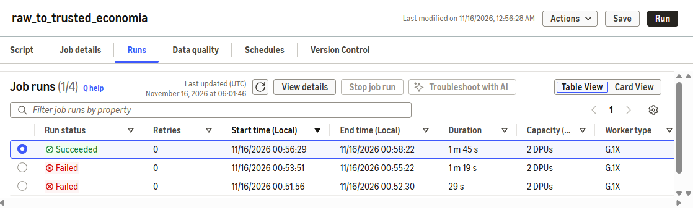
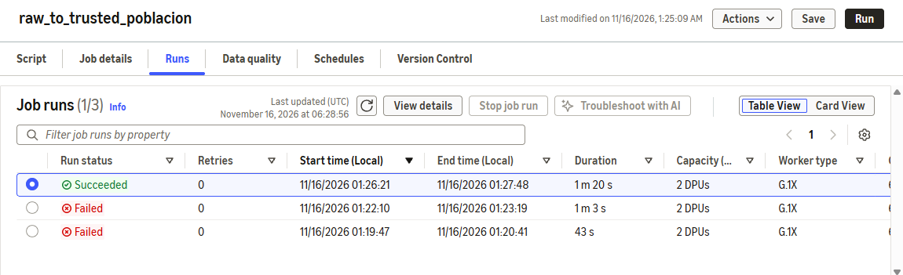
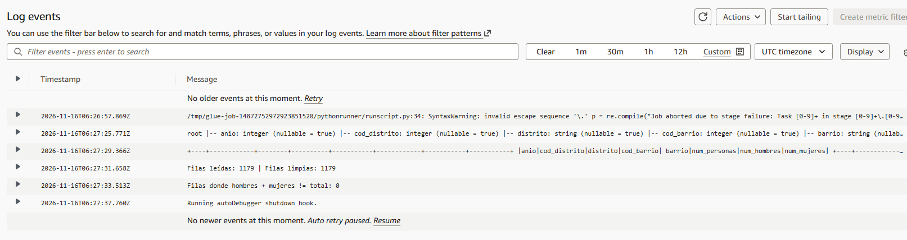
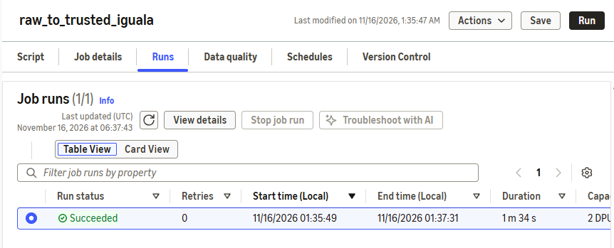
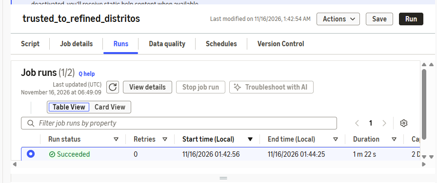

Instrucciones para preparar los datos con AWS Glue y Apache Spark: limpieza de la zona raw hacia trusted y unión de las tablas de trusted en la zona refined.

## Archivos de la carpeta del punto 4

- `raw_to_trusted_economia.py`: job que pasa el CSV de economía y empleo (RDS) a trusted.
- `raw_to_trusted_poblacion.py`: job que limpia el CSV de población (URL) y lo pasa a trusted.
- `raw_to_trusted_iguala.py`: job que limpia los CSV de bienestar e igualdad y de educación y cultura (EC2) y los pasa a trusted.
- `trusted_to_refined_distritos.py`: job que une las cuatro tablas de trusted en una sola tabla de distritos para 2024 en refined.
- `evidencias/`: capturas de cada paso.

## Requisitos previos

- Bucket del punto 3 (`sd-datalake-<sufijo-propio>`, región us-east-1) con la zona raw cargada. Deben existir estos cuatro objetos:
  - `raw/rds/eye_distritos.csv`
  - `raw/url/poblacion.csv`
  - `raw/archivos/iguala-BeI-distritos.csv`
  - `raw/archivos/iguala-EyC-distritos.csv`
- Rol `LabRole` del Learner Lab (es el único que permite el laboratorio y le da a Glue permiso para leer y escribir en el bucket).

## Nombre del bucket

Lo único que se debe cambiar en los scripts es el nombre del bucket, en la variable `BUCKET`:

| Script | Línea |
|---|---|
| `raw_to_trusted_economia.py` | 15 |
| `raw_to_trusted_poblacion.py` | 16 |
| `raw_to_trusted_iguala.py` | 16 |
| `trusted_to_refined_distritos.py` | 17 |

```python
BUCKET = "s3://sd-datalake-sherrerah3"
```

Se reemplaza `sd-datalake-sherrerah3` por el nombre del bucket propio (se mantiene el prefijo `s3://` y no se pone `/` al final).

## Preparación del bucket

En la raíz del bucket creamos las carpetas `trusted/`, `refined/` y `athena-results/` (Create folder), de modo que quedan las cuatro zonas:



## Creación de los jobs

Los cuatro jobs se crean igual. En la consola de AWS Glue entramos a ETL jobs, Script editor, motor Spark, opción Start fresh y Create script. Pegamos el script correspondiente en la pestaña Script y en la pestaña Job details configuramos:

- Name: el nombre del job (igual al nombre del archivo, sin `.py`)
- IAM Role: `LabRole`
- Glue version: 6.0
- Worker type: G.1X
- Requested number of workers: 2
- Job bookmark: Disable
- Job timeout: 10 minutos

Guardamos con Save y ejecutamos con Run. El resultado de cada ejecución se ve en la pestaña Runs, y lo que imprime el script en los Output logs de la ejecución (CloudWatch).

## Job 1: raw_to_trusted_economia

Script: `raw_to_trusted_economia.py`

- Lee `raw/rds/eye_distritos.csv` con encabezado e inferencia de tipos.
- Imprime el esquema, cinco filas y el número de filas leídas.
- Escribe el resultado en Parquet en `trusted/economia_empleo/`.



## Job 2: raw_to_trusted_poblacion

Script: `raw_to_trusted_poblacion.py`

En este archivo no usamos `inferSchema` porque los números vienen con punto como separador de miles (`24.450`) y Spark los interpretaría mal, así que la conversión se hace a mano:

- Lee `raw/url/poblacion.csv` con separador `;` y todo como texto.
- Quita el BOM y los espacios de los nombres de columna.
- Saca el año (`anio`) de la columna `fecha`, convierte códigos a entero y quita los puntos de `num_personas`, `num_hombres` y `num_mujeres`.
- Elimina filas incompletas y duplicadas (por año y barrio).
- Imprime las filas leídas, las filas limpias y cuántas filas tienen `num_hombres + num_mujeres` distinto de `num_personas`.
- Escribe el resultado en Parquet en `trusted/poblacion/`.





## Job 3: raw_to_trusted_iguala

Script: `raw_to_trusted_iguala.py`

- Lee `raw/archivos/iguala-BeI-distritos.csv` y `raw/archivos/iguala-EyC-distritos.csv`.
- Normaliza los nombres de columna (sin tildes, espacios ni guiones) y renombra las columnas clave a `cod_distrito`, `anio`, `ivt_bi` / `ivt_ec` y `ivt_bi_media_ciudad` / `ivt_ec_media_ciudad`, siguiendo el patrón de `ivt_ee` de economía.
- Convierte los códigos y el año a entero y los índices a decimal.
- Deja un registro por distrito y año.
- Escribe cada dataset en Parquet en su carpeta: `trusted/bienestar_igualdad/` y `trusted/educacion_cultura/`.



## Job 4: trusted_to_refined_distritos

Script: `trusted_to_refined_distritos.py`

- Lee las cuatro tablas de trusted y las filtra al año 2024.
- Suma la población de los barrios de cada distrito.
- Une las cuatro tablas por `cod_distrito`.
- Calcula los rankings de población y de cada índice (1 = mayor valor): `rank_poblacion`, `rank_ee`, `rank_bi` y `rank_ec`.
- Imprime el número de distritos y la población total.
- Escribe el resultado en un solo archivo Parquet en `refined/distritos_2024/`.



## Orden de ejecución

1. `raw_to_trusted_economia`, `raw_to_trusted_poblacion` y `raw_to_trusted_iguala`, en cualquier orden.
2. `trusted_to_refined_distritos`, cuando los tres anteriores terminen en Succeeded.

## Verificación

Cada ejecución debe terminar en estado Succeeded. En los Output logs de cada job deben aparecer estos valores:

| Job | Tabla | Resultado esperado |
|---|---|---|
| `raw_to_trusted_economia` | `economia_empleo` | 105 filas |
| `raw_to_trusted_poblacion` | `poblacion` | 1179 filas, y 0 filas donde hombres + mujeres no suman el total |
| `raw_to_trusted_iguala` | `bienestar_igualdad` | 105 filas |
| `raw_to_trusted_iguala` | `educacion_cultura` | 105 filas |
| `trusted_to_refined_distritos` | `distritos_2024` | 21 distritos y población total 3460491 |

Listamos las zonas trusted y refined (debe haber archivos Parquet en cada carpeta):

```bash
aws s3 ls s3://<bucket>/trusted/ --recursive
aws s3 ls s3://<bucket>/refined/ --recursive
```
