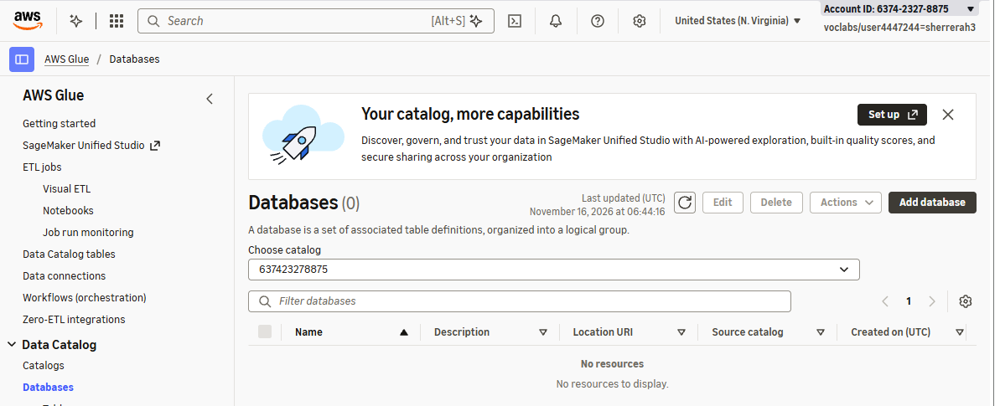
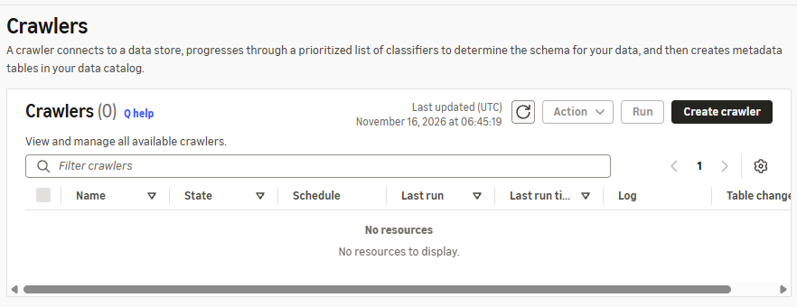
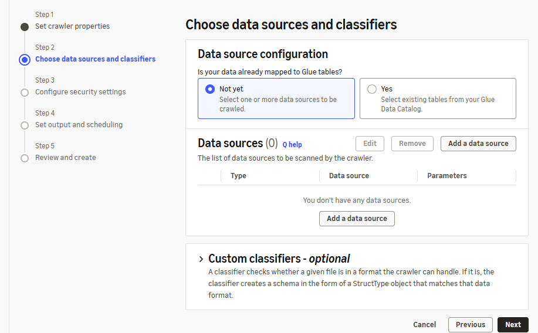
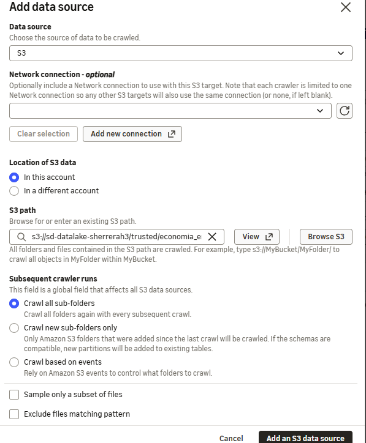
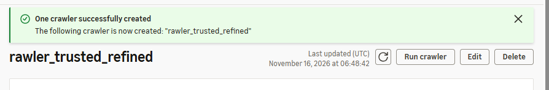
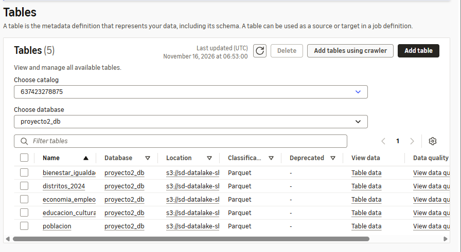
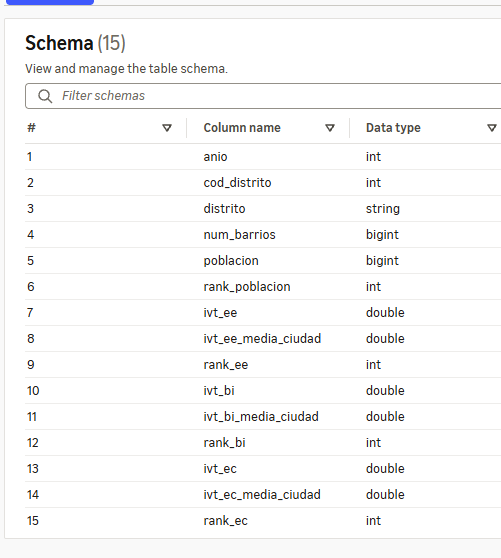

Instrucciones para catalogar las tablas de las zonas trusted y refined en el AWS Glue Data Catalog con un crawler, para poder consultarlas con SQL.

## Archivos de la carpeta del punto 5

- `evidencias/`: capturas de cada paso.

Este punto se hace completo desde la consola de AWS Glue, no tiene scripts.

## Requisitos previos

- Los cuatro jobs del punto 4 ejecutados en Succeeded, con los archivos Parquet en `trusted/` y `refined/`.
- Rol `LabRole` del Learner Lab.

## Nombre del bucket

Lo único que se debe cambiar es el nombre del bucket en las cinco rutas S3 del crawler (paso de fuentes de datos). Se reemplaza `sd-datalake-sherrerah3` por el nombre del bucket propio.

## Creación de la base de datos

Hasta ahora en S3 solo hay archivos Parquet. El crawler los lee, deduce sus columnas y tipos, y crea una tabla por carpeta en el Glue Data Catalog. Después de eso Athena (y EMR) puede consultarlas con SQL.

En la consola de AWS Glue entramos a Data Catalog, Databases y Add database:

- Name: `proyecto2_db`



## Creación del crawler

En Data Catalog, Crawlers, Create crawler:



Paso 1, propiedades del crawler:

- Name: `crawler_trusted_refined`

Paso 2, fuentes de datos. En "Is your data already mapped to Glue tables?" elegimos Not yet y damos Add a data source:



Configuración de cada fuente:

- Data source: S3
- Location of S3 data: In this account
- S3 path: la ruta de la carpeta
- Subsequent crawler runs: Crawl all sub-folders



Repetimos Add a data source hasta tener las cinco rutas, una por carpeta:

```
s3://sd-datalake-sherrerah3/trusted/economia_empleo/
s3://sd-datalake-sherrerah3/trusted/poblacion/
s3://sd-datalake-sherrerah3/trusted/bienestar_igualdad/
s3://sd-datalake-sherrerah3/trusted/educacion_cultura/
s3://sd-datalake-sherrerah3/refined/distritos_2024/
```

Paso 3, seguridad:

- IAM role: Choose an existing IAM role, `LabRole`

Paso 4, salida y programación:

- Target database: `proyecto2_db`
- Crawler schedule (Frequency): On demand

Paso 5: revisamos y damos Create crawler.



## Ejecución del crawler

Desde la página del crawler damos Run crawler y esperamos a que el estado vuelva a Ready.

## Verificación

En Data Catalog, Tables, con la base de datos `proyecto2_db` seleccionada, deben aparecer 5 tablas, todas con clasificación Parquet:

- `bienestar_igualdad`
- `distritos_2024`
- `economia_empleo`
- `educacion_cultura`
- `poblacion`



El esquema de `distritos_2024` debe tener 15 columnas:



## Uso del catálogo desde EMR/Hive

Esta sección es para quien haga las consultas con EMR/Hive y SparkSQL en el punto 6. Para que el clúster vea las tablas de `proyecto2_db` sin volver a crearlas, al crear el clúster de EMR, en la sección AWS Glue Data Catalog settings, se activan las dos opciones:

- Use for Hive table metadata
- Use for Spark table metadata

Con esto Hive y Spark usan el Glue Data Catalog como metastore. Se puede comprobar desde el clúster con:

```sql
SHOW DATABASES;
USE proyecto2_db;
SHOW TABLES;
```
