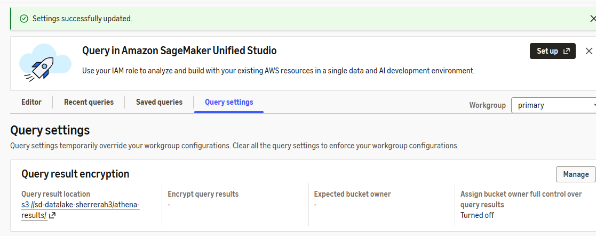
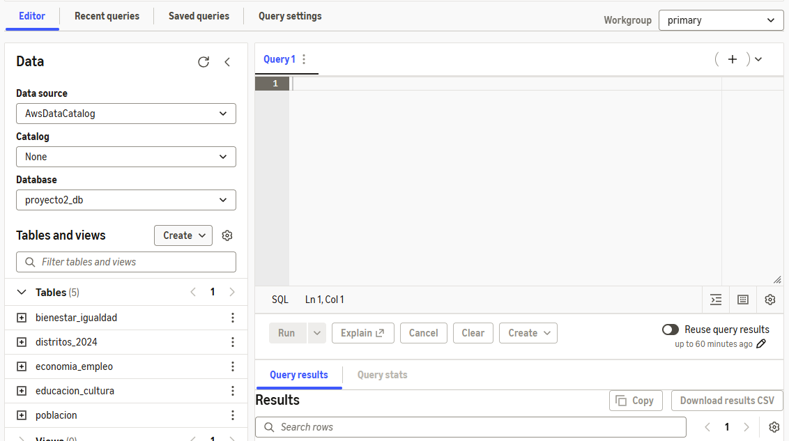
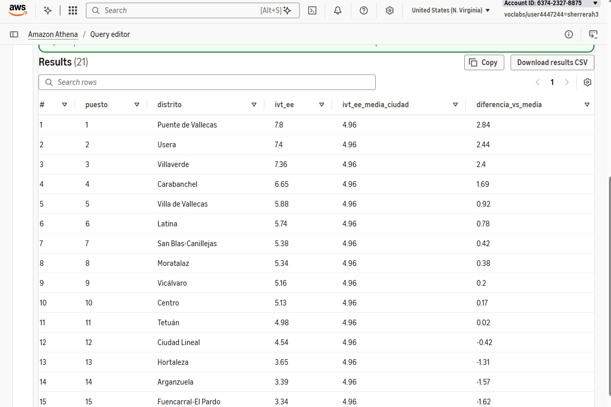
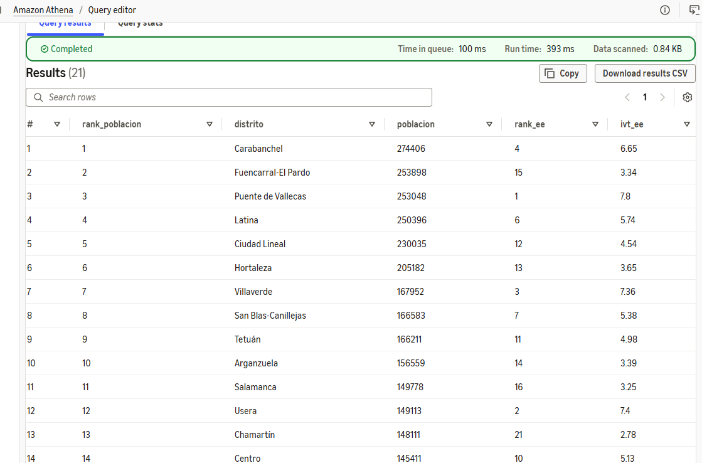
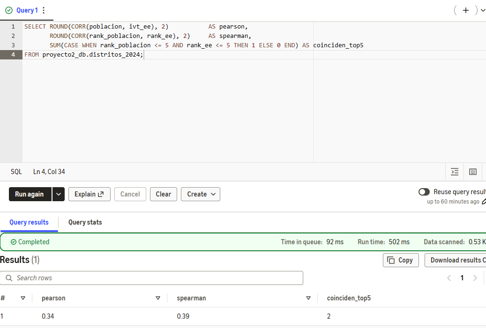
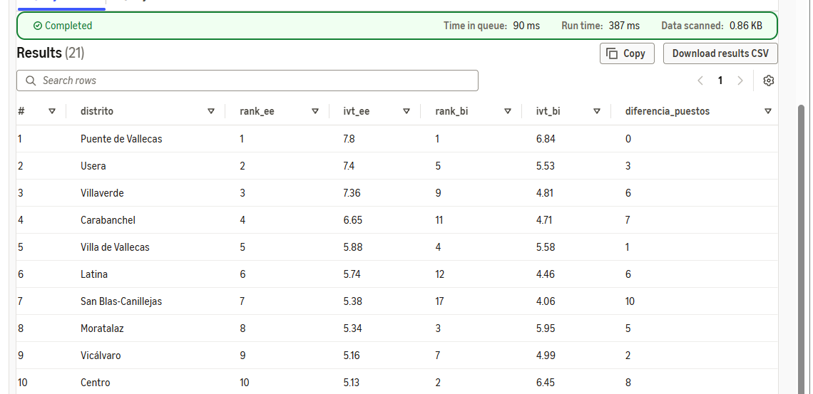
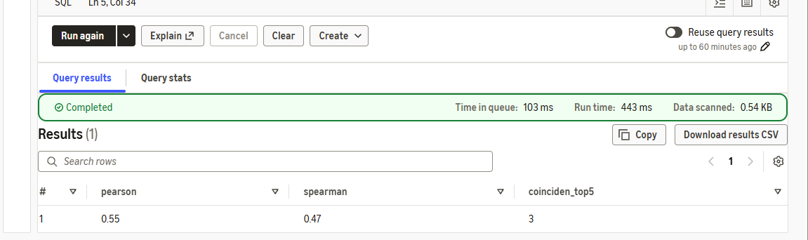
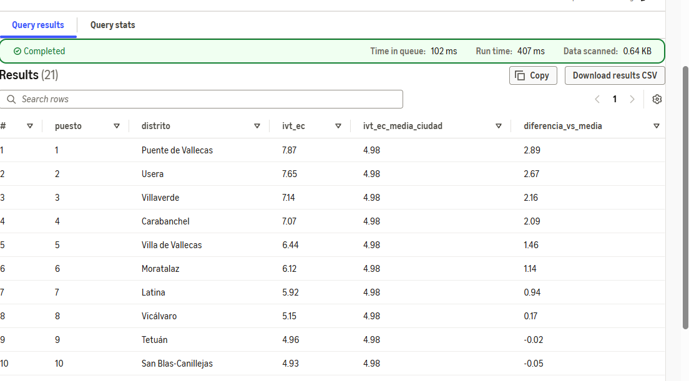
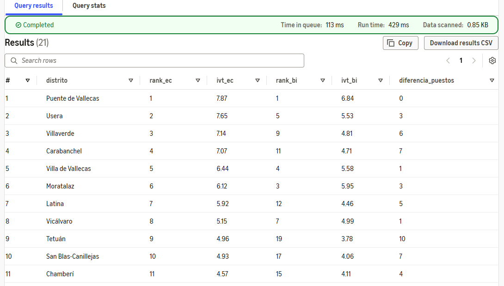
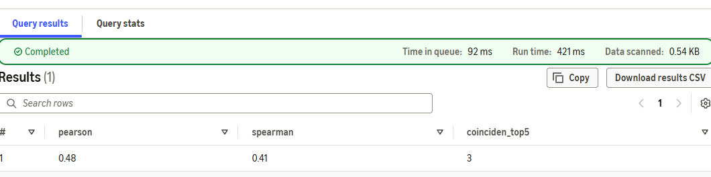

Instrucciones para responder las cinco preguntas del caso de estudio con consultas SQL en AWS Athena sobre la tabla `proyecto2_db.distritos_2024`.

## Archivos de la carpeta del punto 6 (Athena)

- `sql/pregunta1_economia_empleo.sql`: consulta de la pregunta 1.
- `sql/pregunta2_poblacion_vs_economia.sql`: consultas de la pregunta 2 (2a detalle y 2b resumen).
- `sql/pregunta3_economia_vs_bienestar.sql`: consultas de la pregunta 3 (3a detalle y 3b resumen).
- `sql/pregunta4_educacion_cultura.sql`: consulta de la pregunta 4.
- `sql/pregunta5_educacion_vs_bienestar.sql`: consultas de la pregunta 5 (5a detalle y 5b resumen).
- `evidencias/`: capturas de cada paso y de los resultados.

## Requisitos previos

- Punto 5 terminado: base de datos `proyecto2_db` en el Glue Data Catalog con sus 5 tablas.
- Carpeta `athena-results/` creada en la raíz del bucket (punto 4).

## Nombre del bucket

Las consultas no usan el nombre del bucket, solo `proyecto2_db.distritos_2024`. Lo único que se debe cambiar es el bucket en la ubicación de resultados de Athena (siguiente paso).

## Configuración de Athena

En la consola de Amazon Athena entramos a Query editor, pestaña Query settings, Manage, y configuramos:

- Location of query result: `s3://sd-datalake-sherrerah3/athena-results/` (con el bucket propio)

Guardamos con Save.

En la pestaña Editor seleccionamos:

- Data source: AwsDataCatalog
- Database: `proyecto2_db`

Deben aparecer las 5 tablas del crawler:

## Ejecución de las consultas

Copiamos cada consulta del archivo `.sql` correspondiente en el editor y damos Run. En las preguntas 2, 3 y 5 hay dos consultas por archivo (a: detalle y b: resumen), que se ejecutan una por una.

Las consultas de resumen usan estas cifras:

- `pearson`: correlación de Pearson (`CORR`) entre los valores. Va de -1 a 1: cerca de 1 indica que las dos variables suben juntas, cerca de 0 que no hay relación y un valor negativo que una sube cuando la otra baja. Como guía: menos de 0,3 es débil, de 0,3 a 0,7 moderada y más de 0,7 fuerte.
- `spearman`: la misma correlación, pero calculada sobre los rankings en vez de los valores. Es la más adecuada para comparar esferas distintas, porque sus índices no se comparan directamente, pero sus posiciones sí.
- `coinciden_top5`: cuántos de los 5 distritos más altos en una variable también están entre los 5 más altos en la otra.

## Pregunta 1

¿Cuál es el distrito con mayor vulnerabilidad en la esfera de economía y empleo en el año 2024? Mostrar todos los distritos, de mayor a menor.

Consulta: `sql/pregunta1_economia_empleo.sql` (21 filas)

**Respuesta:** Puente de Vallecas, con 7,8 (la media de la ciudad es 4,96). Le siguen Usera, Villaverde, Carabanchel y Villa de Vallecas. El menos vulnerable es Chamartín, con 2,78.

## Pregunta 2

¿Los distritos con mayor población en 2024 corresponden a los distritos con mayor vulnerabilidad en economía y empleo?

Consulta: `sql/pregunta2_poblacion_vs_economia.sql`

Detalle (2a):

Resumen (2b):

| pearson | spearman | coinciden_top5 |
|---|---|---|
| 0.34 | 0.39 | 2 |

**Respuesta:** no mucho. La correlación es baja (0,34 y 0,39) y de los 5 distritos más poblados solo Carabanchel y Puente de Vallecas están en el top 5 de vulnerabilidad. Fuencarral-El Pardo, por ejemplo, es el segundo más poblado y está en el puesto 15.

## Pregunta 3

¿Los distritos con mayor vulnerabilidad en economía y empleo corresponden a los distritos con mayor vulnerabilidad en bienestar e igualdad en 2024?

Consulta: `sql/pregunta3_economia_vs_bienestar.sql`

Detalle (3a):

Resumen (3b):

| pearson | spearman | coinciden_top5 |
|---|---|---|
| 0.55 | 0.47 | 3 |

**Respuesta:** en parte. La correlación es moderada (0,55 y 0,47) y coinciden 3 del top 5: Puente de Vallecas, Usera y Villa de Vallecas. Villaverde y Carabanchel están arriba en economía, pero en bienestar quedan en los puestos 9 y 11.

## Pregunta 4

¿Cuál es el distrito con mayor vulnerabilidad en la esfera de educación y cultura en 2024? Mostrar todos los distritos, de mayor a menor.

Consulta: `sql/pregunta4_educacion_cultura.sql` (21 filas)

**Respuesta:** Puente de Vallecas, con 7,87 (la media de la ciudad es 4,98). El top 5 es el mismo que en economía y en el mismo orden: Puente de Vallecas, Usera, Villaverde, Carabanchel y Villa de Vallecas.

## Pregunta 5

¿Los distritos con mayor vulnerabilidad en educación y cultura corresponden a los distritos con mayor vulnerabilidad en bienestar e igualdad en 2024?

Consulta: `sql/pregunta5_educacion_vs_bienestar.sql`

Detalle (5a):

Resumen (5b):

| pearson | spearman | coinciden_top5 |
|---|---|---|
| 0.48 | 0.41 | 3 |

**Respuesta:** en parte. La correlación es moderada (0,48 y 0,41) y coinciden 3 del top 5: Puente de Vallecas, Usera y Villa de Vallecas. Igual que en la pregunta 3, Villaverde y Carabanchel no aparecen arriba en bienestar.
